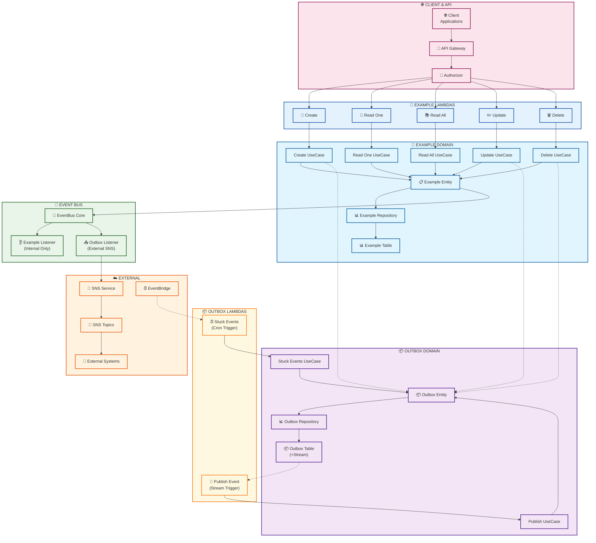

# Example Management Microservice

A serverless microservice built with AWS CDK that manages example entities and implements an outbox pattern for event-driven communication. This service is part of our event-driven architecture and follows Domain-Driven Design principles.

## 🎯 Overview

This microservice provides a complete API for managing example entities with the following capabilities:

- CRUD operations for Example entities
- Event publishing through an Outbox pattern
- Automatic retry mechanism for failed events
- Company-based data isolation
- DynamoDB for persistence
- SNS for event notifications

## 🏛️ Architecture Diagram

The following diagram illustrates the complete architecture of the microservice, showing the flow from client requests through the serverless functions, domain logic, and infrastructure components:



### Architecture Overview

This diagram shows the complete flow of the microservice architecture organized in **7 clear columns** from left to right:

#### 🌐 **Column 1: Client & API**

- **Client Applications**: External applications that consume the API
- **API Gateway**: Entry point with REST endpoints
- **Lambda Authorizer**: Authentication and authorization

#### 📝 **Column 2: Example Lambdas**

- **CRUD Functions**: Individual Lambda functions for each operation
- **API Triggered**: All functions are triggered by API Gateway requests
- **Clean Naming**: Simplified function names for better readability

#### 📝 **Column 3: Example Domain**

- **Use Cases**: Business logic for Example operations
- **Domain Entity**: Example entity with business rules
- **Repository**: Data access abstraction
- **DynamoDB Table**: Dedicated table for Example data

#### 🚌 **Column 4: Event Bus**

- **EventBus Core**: Central event publishing/subscription mechanism
- **Example Listener**: Handles internal business logic only
- **Outbox Listener**: **Only component authorized** to send events to external systems

#### 📦 **Column 5: Outbox Domain**

- **Outbox Entity**: Manages event records for external publishing
- **Repository**: Outbox data access layer
- **Outbox Table**: DynamoDB table with Streams enabled
- **Use Cases**: Publish events and handle stuck events

#### 📦 **Column 6: Outbox Lambdas**

- **Publish Event**: Triggered by DynamoDB Stream
- **Stuck Events**: Triggered by EventBridge cron schedule
- **Event Processing**: Handles reliable event delivery

#### ☁️ **Column 7: External Systems**

- **SNS Service**: Notification service for external events
- **SNS Topics**: AWS SNS topics for event distribution
- **EventBridge**: Scheduled triggers for retry mechanisms
- **External Systems**: Third-party systems consuming events

#### 🔄 **Key Architectural Flows**

1. **Request Flow**: Client → API Gateway → Auth → Example Lambdas → Use Cases → Domain → Repository → Table
2. **Event Flow**: Example Entity → EventBus → Listeners (Internal vs External)
3. **Outbox Pattern**: Use Cases → Outbox Entity → DynamoDB Stream → Outbox Lambdas → EventBus → SNS
4. **Retry Mechanism**: EventBridge → Stuck Events Lambda → Process failed events

The **columnar layout** eliminates crossing lines and makes the flow easy to follow from left to right, clearly showing the separation between Example and Outbox bounded contexts.

## 🤖 AI-Driven Development Workflow

This project follows a structured AI-driven development process to ensure consistency and maximize productivity:

### 1. Document Use Cases First

Before any coding begins:

- Create a new `.md` file in `/docs/useCases/{Module}/` directory
- Follow the AI-readable structure (see [CreateExample.md](docs/useCases/Example/CreateExample.md) as reference)
- Include all necessary details:
  - Objective
  - Input/Output
  - Validations
  - Side Effects
  - Business Rules

### 2. Leverage Structured Prompts

The `/prompts` directory contains well-defined templates for common development tasks:

- `new_domain_module.md` - Creating new domain entities
- `new_use_case.md` - Implementing use cases
- `new_infra_adapter.md` - Adding infrastructure adapters
- `extend_existing_feature.md` - Extending existing functionality
- `write_test.md` - Writing comprehensive tests

### 3. IDE Configuration

The skeleton comes pre-configured for AI-assisted development:

#### Cursor IDE (Pre-configured)

- The skeleton includes built-in rules that automatically instruct the AI to:
  1. Check `/prompts` directory for applicable templates
  2. Follow the template guidelines when implementing code
  3. Maintain project patterns and standards

#### Other IDEs

If using a different IDE with AI capabilities, configure it to:

1. Set the `/prompts` directory as the primary source of development templates
2. Instruct the AI to check for applicable prompts before code generation
3. Follow the structured workflow:
   - Review use case documentation
   - Apply relevant prompts
   - Generate implementation
   - Follow project patterns

Note: You can use the prompt in `.cursor/rules/general-rule.mdc` as a guide.

### 4. AI-First Implementation

Development process:

1. AI assistant checks `/prompts` for applicable templates
2. Developer points AI to the use case `.md` file
3. AI implements the base code following project patterns
4. Developer reviews and adjusts the implementation as needed

This workflow ensures:

- Consistent documentation
- Standardized implementations
- Reduced boilerplate coding
- Better maintainability
- Faster development cycles

## 🏗️ Architecture Components

### Example Module

The core domain module that handles example entity management with the following features:

- Create new examples with validation
- Update existing examples
- Delete examples
- Read single example by ID
- List all examples for a company
- Status management
- Event generation for state changes

### Outbox Module

Implements the Outbox pattern for reliable event publishing:

- Stores domain events before publishing
- Handles event publishing to SNS
- Provides automatic retry for failed events
- Implements stuck event recovery

## 🚀 API Endpoints

### Example Management

- `POST /examples` - Create a new example
- `GET /examples/{id}` - Get example by ID
- `GET /examples` - List all examples
- `PUT /examples/{id}` - Update an example
- `DELETE /examples/{id}` - Delete an example

### Event Management

- `POST /outbox/publish` - Manually publish an outbox event
- `POST /outbox/publish-stuck` - Process stuck events (called by EventBridge)

## 💾 Data Model

### Example Entity

- `id` (UUID)
- `idCompany` (String)
- `name` (String, max 20 chars)
- `description` (String, max 255 chars)
- `status` (Enum: ACTIVE, INACTIVE)
- `createdAt` (Timestamp)
- `updatedAt` (Timestamp)

### Outbox Entity

- `id` (UUID)
- `entityId` (String)
- `entityType` (String)
- `eventType` (String)
- `eventBody` (JSON)
- `status` (Enum: PENDING, PROCESSED, FAILED)
- `retries` (Number)
- `timestamp` (Number)

## 🔧 Local Development

1. Set up Node.js version (if using nvm):

```bash
nvm use
```

This will automatically use the Node.js version specified in `.nvmrc`

2. Install dependencies:

```bash
npm install
```

3. Run tests:

```bash
npm run test
```

4. Test lambdas locally:

```bash
npm run dev
```

5. Deploy to AWS:

```bash
cdk deploy
```

## 📚 Documentation

Detailed documentation for each use case can be found in the `docs/useCases` directory:

- Example Module
  - [Create Example](docs/useCases/Example/CreateExample.md)
  - [Delete Example](docs/useCases/Example/DeleteExample.md)
  - [Read All Examples](docs/useCases/Example/ReadAllExample.md)
  - [Read One Example](docs/useCases/Example/ReadOneExample.md)
  - [Update Example](docs/useCases/Example/UpdateExample.md)
  - [Delete Inactive Examples](docs/useCases/Example/DeleteInactiveExamples.md)

- Outbox Module
  - [Publish Outbox Event](docs/useCases/Outbox/PublishOutboxEvent.md)
  - [Publish Stuck Events](docs/useCases/Outbox/PublishStuckOutboxEvents.md)

## 📦 Infrastructure

This service is deployed using AWS CDK and includes:

- Lambda functions for each use case
- DynamoDB tables for Example and Outbox entities
- SNS topics for event publishing
- EventBridge rules for scheduled tasks
- API Gateway for REST endpoints

For detailed information about the base architecture and development guidelines, see [SKELETON_GUIDE.md](SKELETON_GUIDE.md).
