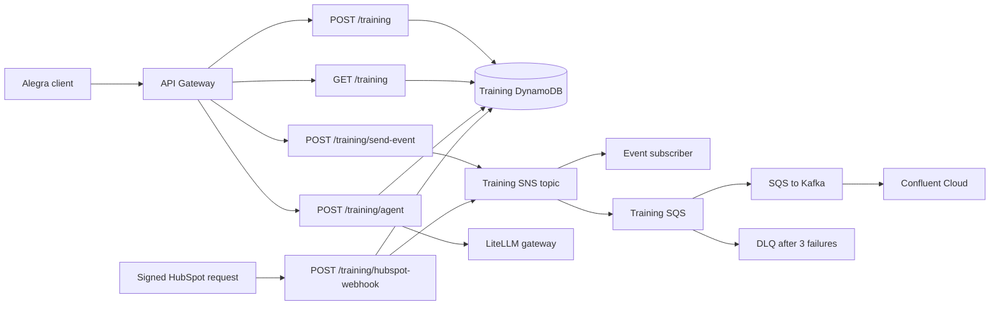

# Challenge Onboarding Backend

Serverless backend for the Alegra onboarding challenge. It is an AWS CDK app (`@alegradev/cdkless`) that deploys the Training API for `challenge-onboarding-sofia` in `us-east-1`, stage `training`.

Infrastructure (DynamoDB, SNS, SQS and the DLQ) lives in the separate `challenge-onboarding-infra` repository. This repo deploys the Lambdas, the HTTP API and their permissions. `stacks/App.ts` builds only the Training stack. The Example and Outbox code from the skeleton is still in the tree and is covered by tests, but it is not deployed.

Public API base URL:

```text
https://xzysdjozxe.execute-api.us-east-1.amazonaws.com/v1
```

## Flow



Authorized routes use the Alegra Lambda authorizer. `idCompany` and `idUser` come from the token. The HubSpot webhook has no Alegra authorizer: its security is the HubSpot v3 signature.

## Endpoints

| Method and path | Auth | What it does |
| --- | --- | --- |
| `POST /v1/training` | Alegra | Stores a training request (`documentType`, `fromDate`, `toDate`) with `pk = COMPANY#<idCompany>` and `sk = TRAINING#<id>`. |
| `GET /v1/training` | Alegra | Lists the company trainings. It queries `TRAINING#` keys only. |
| `POST /v1/training/send-event` | Alegra | Publishes a `TrainingEventSent` message to the training SNS topic. |
| `POST /v1/training/agent` | Alegra | Runs a two-node LangGraph agent. Body: `{ "message": "..." }`. Response: `{ "intent", "reply" }`. |
| `POST /v1/training/hubspot-webhook` | HubSpot v3 signature | Validates the signature, stores the events and publishes each one to SNS. |

SNS has two consumers:

- `training-event-subscriber` logs the event in CloudWatch.
- `sqs-to-kafka` reads the training queue and publishes an Avro record to the Confluent topic `revops-training-events-sofia-castrillon`. A message whose `timestamp` in seconds is even fails on purpose. SQS retries it 3 times and then moves it to the DLQ.

## Agent

`classify` labels the message as `ventas`, `soporte` or `cancelacion`. `respond` writes a short Spanish reply. The model is `openai/gpt-4.1-mini`, called through the Alegra LiteLLM gateway (`https://alegra-litellm.alegra.com/v1`), not directly against OpenAI.

Each turn is stored in the training table with `pk = AGENT#<idCompany>` and `sk = MESSAGE#<timestamp>#<id>`. The Lambda logs `message`, `intent` and `reply` in `challenge-onboarding-sofia-training-agent-training-log-group`.

## HubSpot

Signature: `base64(HMAC-SHA256(secret, method + uri + body + timestamp))`. Requests older than 5 minutes, or with a bad signature, return 401 and write nothing. An invalid body returns 400.

Events are stored with `pk = HUBSPOT#<objectId>` and `sk = EVENT#<occurredAt>#<propertyName>`, then published as `TrainingEventSent` with `eventType = hubspot.propertyChange`.

## Secrets

Secrets are SecureString parameters in SSM. They are created by hand and are not in this repository.

| Parameter | Used by |
| --- | --- |
| `/challenge-onboarding-sofia/hubspot/webhook-secret` | HubSpot signature check |
| `/challenge-onboarding-sofia/agent/api-key` | LiteLLM API key |
| `/challenge-onboarding-sofia/confluent/*` | Kafka and Schema Registry credentials |

## Local development

Requirements: Node.js 20 or newer, npm, and the AWS CLI signed in to the training account (`aws sso login`).

```bash
npm install
npm test
npm run dev
npm run deploy
```

- `npm test` runs Jest and skips `*.integration.*` tests.
- `npm run dev` opens the local Lambda runner.
- `npm run deploy` compiles the shared layer and runs `cdk deploy --all`. The layer copy uses `scripts/copy-layer-modules.cjs` (`fs.cpSync`). Do not switch it back to `ncp`: on Windows, `ncp` can write empty `package.json` files and the Lambda then fails to start.
- A pre-commit hook runs `npm test` and `npm run lint`.

Root `.env` needs at least:

```dotenv
AWS_REGION_ID=us-east-1
STAGE=training
LAMBDA_AUTHORIZER_ARN=<alegra authorizer arn>
SENTRY_DSN=
```

`PROJECT_NAME` in `stacks/constants.ts` must stay `challenge-onboarding-sofia`, the same name used by the infra stack. CDK reads the table, topic and queue names from the infra stack outputs.

## Documentation

Task specs are in `docs/specs`. Use cases are in `docs/useCases/Training`. Prompts for new work are in `prompts/`.

| Task | Spec |
| --- | --- |
| 08 GET /training | [docs/specs/08-get-training.md](docs/specs/08-get-training.md) |
| 09 send event | [docs/specs/09-send-training-event.md](docs/specs/09-send-training-event.md) |
| 10 SNS subscriber | [docs/specs/10-training-event-subscriber.md](docs/specs/10-training-event-subscriber.md) |
| 11 SQS to Kafka | [docs/specs/11-sqs-to-confluent-kafka.md](docs/specs/11-sqs-to-confluent-kafka.md) |
| 12 even timestamp to DLQ | [docs/specs/12-intentional-error-even-timestamp.md](docs/specs/12-intentional-error-even-timestamp.md) |
| 13 HubSpot webhook | [docs/specs/13-hubspot-webhook.md](docs/specs/13-hubspot-webhook.md) |
| 15 training agent | [docs/specs/15-training-agent.md](docs/specs/15-training-agent.md) |

The skeleton guide is still in [SKELETON_GUIDE.md](SKELETON_GUIDE.md). It describes the original Example and Outbox template, not the deployed Training stack.
